# Job Search RAG

Desktop app (Electron + Node.js + React) that automates most of a job search. It builds a local knowledge base
about you (RAG), scores your fit for each job, writes a tailored resume and cover letter, fills in applications
(LinkedIn Easy Apply or the company's own site), messages recruiters, and keeps your applications board up to date
by reading the replies in your inbox. Every generated word is grounded in facts about you, and the base grows as you
use the app.

It runs on **Windows, Linux and macOS** and, by default, on your **Claude subscription** through the Claude Code CLI,
so no API key is needed. The UI and generated documents default to **English**; resumes and cover letters can also be
generated in Portuguese.

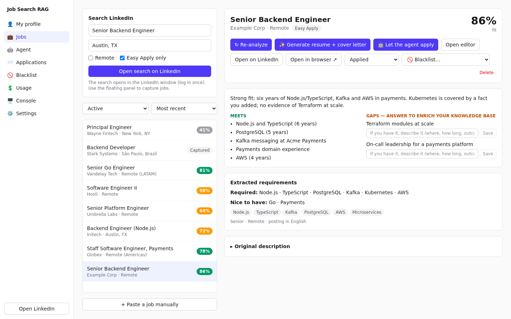

> The screenshots use the browser preview (`npm run dev:web`) with made-up sample data.

## Contents

- [Quick start](#quick-start)
- [Screens and features](#screens-and-features)
  - [Dashboard](#dashboard)
  - [My profile and knowledge base](#my-profile-and-knowledge-base)
  - [Jobs](#jobs)
  - [Document editor](#document-editor)
  - [LinkedIn window and capture panel](#linkedin-window-and-capture-panel)
  - [Agent](#agent-fully-automatic-mode)
  - [Applications board and email replies](#applications-board-and-email-replies)
  - [Blacklist](#blacklist)
  - [Usage and budget](#usage-and-budget)
  - [Console](#console)
  - [Settings, backup and reset](#settings-backup-and-reset)
- [Navigation](#navigation)
- [How it works](#how-it-works)
- [Development](#development)
- [Builds and CI](#builds-and-ci)
- [Tests](#tests)
- [Notes and limits](#notes-and-limits)

## Quick start

```bash
npm install
npm run dev        # Electron app with hot reload
```

1. **Settings → Text generation.** The default provider is **Claude subscription (claude -p)**: it uses your Claude
   Pro/Max plan through the Claude Code CLI. Install Claude Code, run `claude` once and log in, then click
   **Check CLI**. Alternatives: Claude API (API key), OpenAI, or Ollama (local). Settings save automatically.
2. **My profile** → import your current resume (PDF/DOCX) and/or fill in experience, education, skills…
3. **Jobs** → *Open search on LinkedIn* and capture jobs with the floating panel, or paste a job by hand.
4. Open a job, answer its **gaps** (each answer becomes a fact), and click **Generate resume + cover letter**.
5. Review the documents in the **editor** and export PDF/DOCX, or let the **Agent** apply for you.
6. Follow everything on the **Applications** board; **Check email replies** moves the cards for you.

## Screens and features

### Dashboard

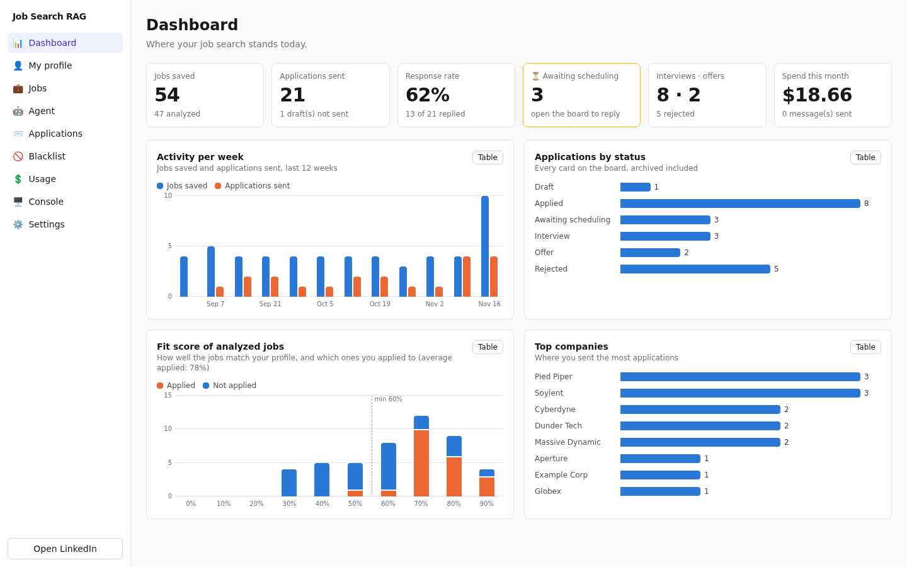

The home page shows where the search stands today:

- **Headline numbers**: jobs saved (and analyzed), applications sent (and drafts not sent yet), **response rate**
  (replies ÷ applications sent), applications **awaiting interview scheduling** (highlighted, opens the board),
  interviews and offers (and rejections), and this month's spend (and messages sent to recruiters).
- **Activity per week**: jobs saved and applications sent over the last 12 weeks.
- **Applications by status**: every card on the board, archived ones included.
- **Fit score of analyzed jobs**: how well the jobs match your profile, split into applied / not applied, with your
  minimum score marked and the average score of the jobs you applied to.
- **Top companies**: where you sent the most applications.

Hover any bar for its values; **Table** shows each chart's numbers as a table. Light and dark mode follow the system.

### My profile and knowledge base

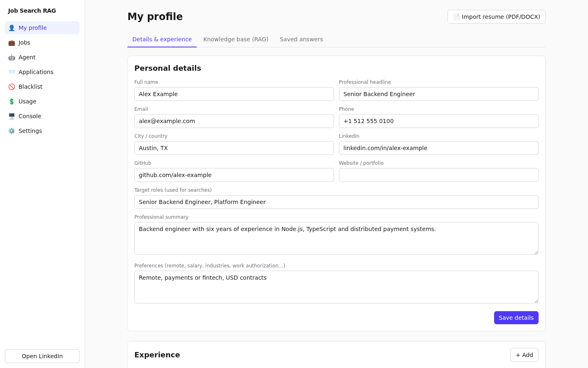

- **Details & experience.** Personal details, target roles (used to build searches), summary and preferences
  (remote, salary, industries, work authorization), plus experience, education, skills, projects, certifications and
  languages.
- **Import resume.** PDF (pdf.js, also reads PDFs with broken cross-reference tables), DOCX (mammoth) or text. The AI
  maps it into your profile, only filling empty fields and never duplicating items.
- **Knowledge base (RAG).** Every profile item becomes atomic "facts", embedded locally (transformers.js, free) or via
  OpenAI/Ollama, and retrieved per job requirement. It also grows from your answers to job gaps, Easy Apply answers,
  answers you give the agent, and new bullets you write in the editor. Delete facts one by one, in bulk, or everything
  matching a filter; deleted profile-derived facts stay excluded even after reindexing.
- **Saved answers.** Application-form questions and your answers ("Notice period?", "Expected salary?"), reused by
  Easy Apply and the agent.

### Jobs


- **Search LinkedIn** from the profile's target role and location (remote / Easy Apply filters), in the LinkedIn
  window, or **paste a job manually** (any site).
- **Fit analysis**: extracted requirements (must-have, nice-to-have, keywords, seniority, work model, language) and a
  **fit score** with what you meet and what is missing.
- **Gaps**: each missing requirement has a box: if you do have that experience, describe it and it becomes a fact,
  so the next resume can use it. Requirements without evidence never turn into resume bullets.
- Actions: **Generate resume + cover letter**, **Let the agent apply**, open the editor, open the job on LinkedIn or
  in your browser, change its status, **blacklist** the job or the company, delete.
- Filter by status (lead, captured, analyzed, applied, discarded) and sort by date or best fit.

### Document editor

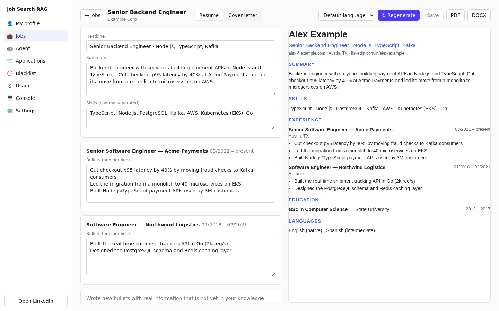

- Resume and cover letter side by side with a live preview, generated in English or Portuguese.
- Edit headline, summary, skills and bullets per experience; **Regenerate** at any time.
- Export **PDF** (Electron `printToPDF`) or **DOCX** (`docx`).
- New facts you write in the editor can be **learned** into the knowledge base.
- Writing rules from Wikipedia's [Signs of AI writing](https://en.wikipedia.org/wiki/Wikipedia:Signs_of_AI_writing)
  ([`src/shared/writingCheck.ts`](src/shared/writingCheck.ts)): cover letters get an automatic revision pass when the
  checker flags something.

### LinkedIn window and capture panel

*(Desktop app only, so there is no screenshot.)* A LinkedIn window with a persistent session and a floating panel:

- **Capture & analyze job**: saves the open job (title, company, description, Easy Apply) and shows the fit score
  in the panel. A toolbar captures every result of a search page at once.
- **Fill Easy Apply** on each step: green = saved answer, blue = AI suggestion, orange = fill it in yourself. The
  tailored resume is attached automatically. **You review and click Submit**: the panel never submits.
- A mini console with *Copy log* for troubleshooting.
- Log in with your **LinkedIn email and password** once (the session is kept). *Continue with Google* does not work
  in embedded browsers. If your account only uses Google, set a LinkedIn password once via *Forgot password*.

### Agent (fully automatic mode)

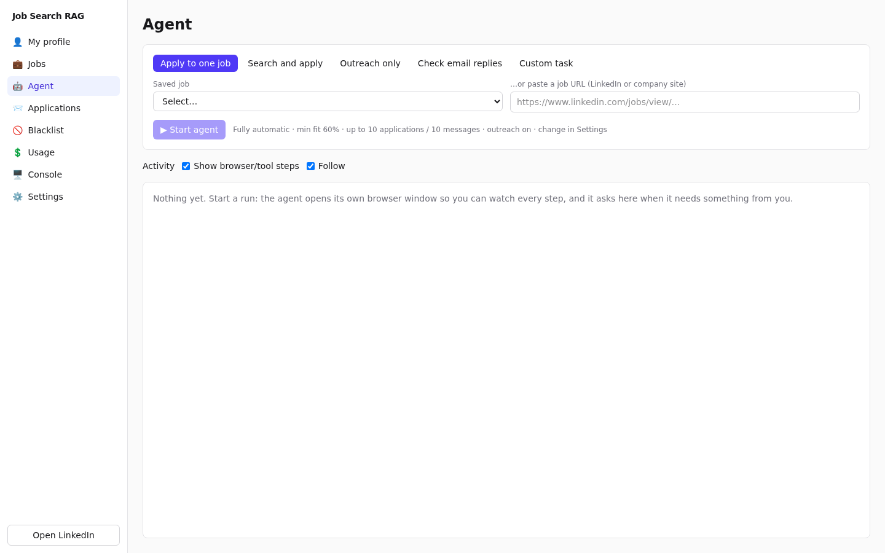

The **Agent** page runs Claude Code in the background (`claude -p` on your subscription) and lets it drive a
**visible browser**, so you can watch every step. Tasks:

| Task | What the agent does |
|---|---|
| **Apply to one job** | A saved job or any job URL: open, save, score, close gaps, tailor documents, apply, reach out |
| **Search and apply** | Searches a source and applies to the best N jobs above your minimum score |
| **Outreach only** | Finds the job poster / recruiter / hiring manager and messages up to 3 people |
| **Check email replies** | Reads companies' replies in your inbox and updates the applications board (see below) |
| **Custom task** | Free-text instructions, with the same ground rules |

Search sources: **LinkedIn Jobs**, **remote job boards** open to Latin America (Himalayas, Get on Board, Remotive, We
Work Remotely, Working Nomads, RemoteOK, Work at a Startup, plus Gupy and Programathor in Brazil), **Wellfound**,
**Google** (Greenhouse, Lever, Ashby, Workable… career sites and Google Jobs) and **recently funded startups**
(funding news from the last 3–18 months, then their open roles).

In one run the agent can:

1. search, triage results (never re-opening jobs it already saw, applied to or that are blacklisted) and score
   each job against your knowledge base;
2. close important gaps by **asking you**. It only asks about knowledge it can't find (and human-only steps:
   logging in, CAPTCHAs, verification codes). Every answer is saved to the knowledge base;
3. tailor your resume and export PDF/DOCX; write a cover letter when the form has a field for it (or always);
4. apply through **Easy Apply** or the company's own site/ATS (Greenhouse, Lever, Ashby, Workday, Gupy…), filling
   every question from saved answers and grounded facts. It detects applications you made by hand and never applies
   twice to the same job (or to a repost at the same company);
5. find the right people and **send a short message** or connection note, never twice to the same person.

Questions and approvals appear as cards on the page, with an OS notification. Every final Submit/Send goes through
`request_permission`, which enforces the run limits.

**Controls** (Settings → Agent): browser (Chrome or Edge via Playwright with its own persistent profile, or the Claude
in Chrome extension), model, minimum fit score, max applications and messages per run, outreach on/off, always write
a cover letter, **ask me before each final Submit/Send** (off by default = fully automatic), **dry run** (fills
everything, never submits), **keep going after errors** (and how many attempts per run) and standing instructions
for every run.

**The agent does not stop at the first error.** A problem with one job (a broken form, a closed job, a page that
won't load) is recorded as *failed* and the agent moves on to the next job. If the whole attempt ends early (Claude
Code crashes, the browser is lost, or a search ends short of its goal), the app starts a **fresh attempt** of the same
run 15 seconds later, telling it what was already done so nothing is repeated. It keeps going until:

- the run has the applications it asked for (the smaller of *best N jobs* and *max applications per run*);
- the **Claude usage limit or credits run out**, or the app's budget (Usage) blocks further spending;
- the agent calls `end_run` (LinkedIn warned about automated activity, or you answered *Stop the run*);
- 3 attempts in a row add no new application (no more matching jobs for now), or the attempt limit is reached;
- you press **Stop**.

The run header shows the current attempt; limits (applications, messages) count across all attempts of a run.

Each step is a skill in the bundled Claude Code plugin [`agent-plugin/`](agent-plugin/skills): `job-agent`
(orchestrator), `search-strategy`, `find-jobs`, `find-jobs-remote-boards`, `find-jobs-wellfound`, `find-jobs-google`,
`find-funded-startups`, `knowledge-grounding`, `tailor-documents`, `cover-letter`, `easy-apply`, `external-apply`,
`find-contacts`, `outreach-message`, `send-linkedin-message`, `check-email` and `human-writing`.

### Applications board and email replies

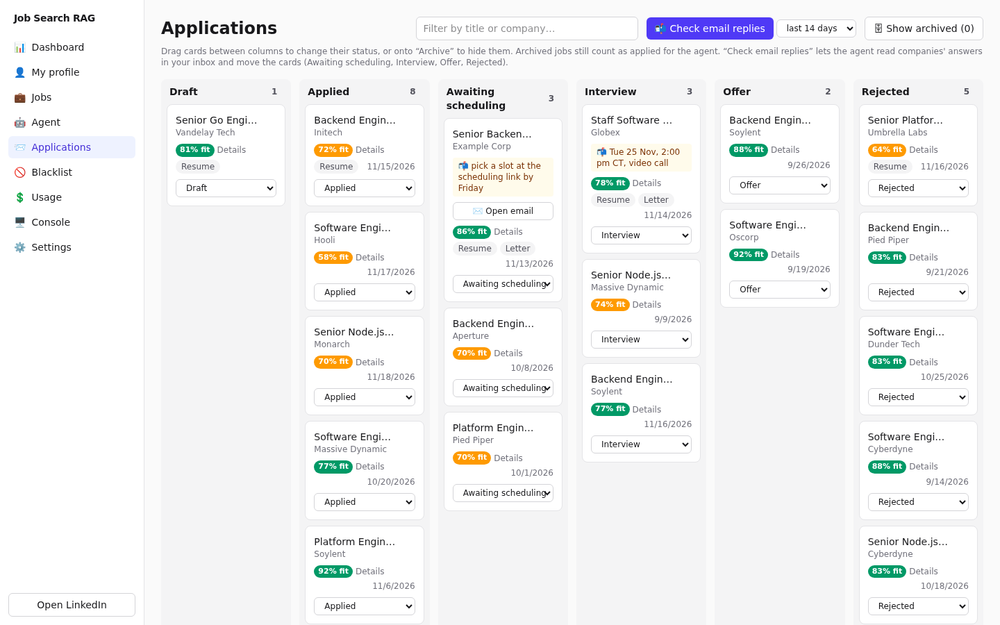

- A kanban board: **Draft → Applied → Awaiting scheduling → Interview → Offer → Rejected**. Drag cards between
  columns (or use the select on each card), drop them on *Archive* to hide them (archived jobs still count as applied
  for the agent), and filter by title or company.
- Each card opens the resume/cover letter; **Details** opens the job's fit analysis. The **fit score badge** (green
  ≥ 75%, amber ≥ 50%, gray below) shows how well the job matched your profile.
- Cards in **Awaiting scheduling** have an **✉️ Open email** button that opens the company's email in your browser,
  so you can pick a slot or answer right away (Gmail opens the message itself; for webmail the agent records the
  message's address, otherwise the mailbox search for its subject opens).
- **📬 Check email replies** starts the agent's email task for the chosen period (3–60 days):

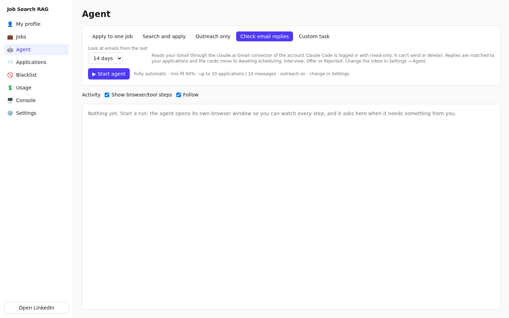

  - It reads replies from companies and ATSs (Greenhouse, Lever, Ashby, Workable, Gupy, Rippling, LinkedIn messages…)
    and moves each application: **Awaiting scheduling** (they want to talk and no date is confirmed yet: scheduling
    link, availability request), **Interview** (date confirmed), **Offer** or **Rejected**.
  - The card shows the **next step** taken from the email (the scheduling link, a deadline, the interview time).
  - Applications you made outside the app are added to the board from their confirmation emails.
  - Each email is recorded once, and an offer or rejection is never reopened by a misread email.
  - **Inbox** (Settings → Agent): **Gmail through the claude.ai Gmail connector** of the account Claude Code is logged
    in with (connect it once at claude.ai → Settings → Connectors). Only search/read tools are allowed: the agent
    cannot send, reply, draft, label or delete. Or **webmail in the agent's browser** (Outlook.com / Hotmail, or any
    other webmail URL), read-only.

### Blacklist

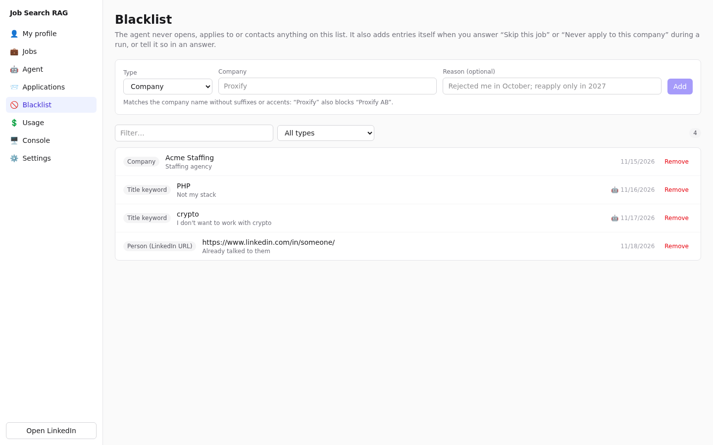

Companies, specific jobs, title keywords and people the agent must **never** apply to or contact. Entries come from
you (this page, the Jobs page, the standing instructions) or from your answers during a run ("never Proxify", "I
don't want to work with crypto"). Every run's prompt lists them, and the agent's tools (`check_jobs`, `save_job`,
`request_permission`) enforce them.

### Usage and budget

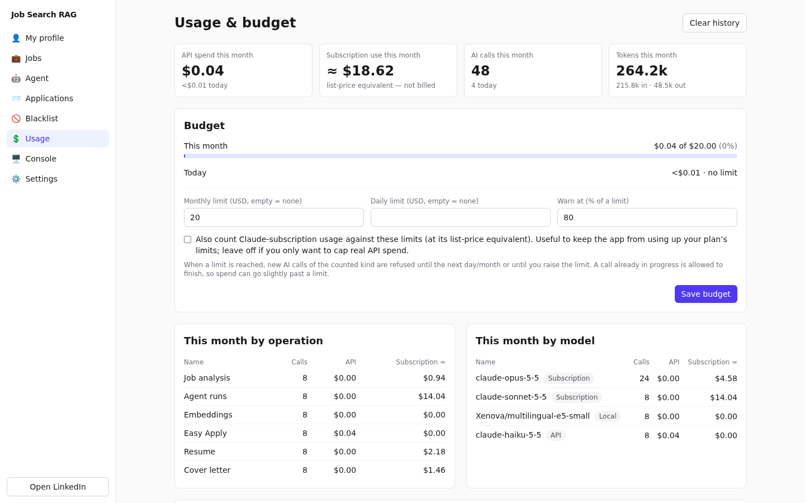

- Every AI call is logged with provider, model, operation, tokens, cost and billing type (API / subscription /
  local), grouped by operation and by model.
- **Monthly and daily limits** in USD with a warning threshold. When a limit is reached, new API-billed calls are
  refused before reaching the provider.
- Subscription usage is shown at its list-price equivalent (reported by the CLI, not an actual charge) and can
  optionally count toward the limits, so the app doesn't drain your plan.
- Prices are editable (built-in Claude list prices; OpenAI values are estimates).

### Console

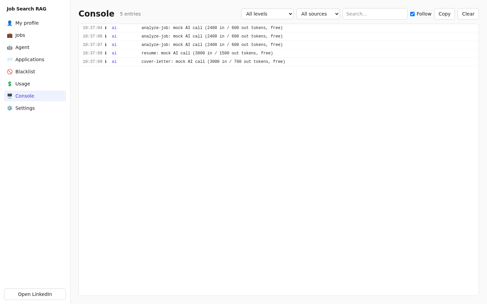

What the app is doing and why something failed: app, LinkedIn panel, AI, CLI, embeddings, import, IPC, documents and
agent logs, filterable by level and source, searchable, with *Copy*. Also written to `<userData>/logs/app.log`.

### Settings, backup and reset

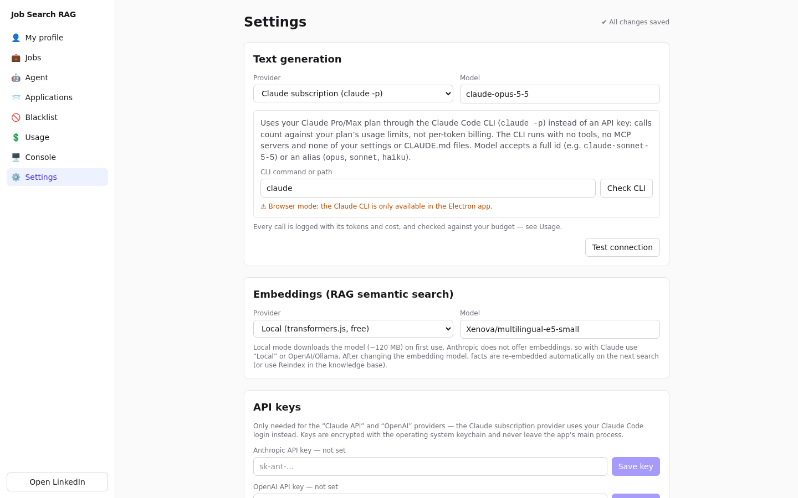

- **Text generation**: Claude subscription (`claude -p`), Claude API, OpenAI or Ollama, with model and a
  **Check CLI** / **Test** button. **Embeddings**: local (free), OpenAI or Ollama. **API keys** are encrypted with the
  OS keychain (`safeStorage`) and never reach the UI.
- **Agent**: everything described above, including the inbox used for email checks.
- **Other**: Ollama URL and the default language of generated documents.

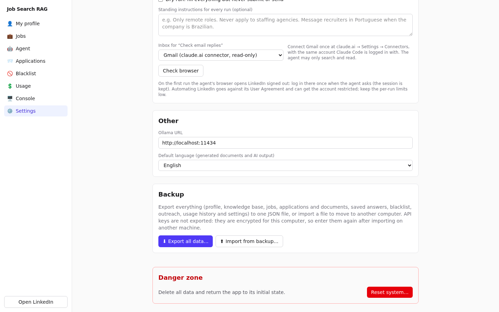

- **Backup**: **Export all data** saves everything (profile, knowledge base, jobs, applications and documents, saved
  answers, blacklist, outreach, usage history and settings) to one JSON file. **Import from backup** replaces all
  current data with a file's (after a confirmation), e.g. to move to another computer. API keys are not exported
  (they are encrypted for this computer); embeddings are rebuilt after an import.
- **Danger zone → Reset system…** deletes all data (database, settings, API keys and the LinkedIn session) after you
  type `RESET`. Exported files and the downloaded embedding model are kept.

## Navigation

**Back** returns to the page you came from: Applications → documents → job details → Back → Back takes you to the
Applications board again. The mouse back button and **Alt+←** do the same. The sidebar starts a fresh history.

## How it works

**No fabrication.** Every prompt restricts the AI to your profile and the retrieved facts. Requirements without
evidence become gaps (questions to you), not bullets.

**Claude subscription instead of API tokens.** The *Claude subscription (claude -p)* provider runs the Claude Code
CLI headless, so calls count against your plan's limits instead of per-token billing. Each call runs with no tools,
no MCP servers, none of your settings/CLAUDE.md files, no saved session, and without `ANTHROPIC_API_KEY`. If `claude`
is not on the app's PATH, the app also looks in the installer's default location (`~/.local/bin`, i.e.
`%USERPROFILE%\.local\bin\claude.exe` on Windows). Meant for personal use of your own subscription.

**Agent wiring** (`src/main/agent/`). The app serves its own MCP server (`jobsearch`, Streamable HTTP on 127.0.0.1
with a random token) with the knowledge base, document export, form-answer memory, application and outreach records,
the blacklist, `ask_user` and `request_permission`. The browser is
[Playwright MCP](https://github.com/microsoft/playwright-mcp) with your installed Chrome or Edge and its own
persistent profile, or the Claude in Chrome extension. The CLI runs isolated: only the plugin's skills,
`--setting-sources ""`, `--strict-mcp-config`, built-in tools limited to Skill/TodoWrite (no shell, no file edits),
`--permission-mode dontAsk` with an allowlist of the MCP servers. Gmail email checks are the one exception: strict
MCP config is off so the claude.ai connectors load (through ToolSearch), and the allowlist adds only the Gmail
connector's read tools (`search_threads`, `get_thread`, `get_message`, `list_labels`).

| Layer | Files |
|---|---|
| Database (SQLite, `better-sqlite3`) | `src/main/db/` — profile, facts, embeddings, jobs, applications, outreach, blacklist, question memory, AI usage log; `backup.ts` (export/import) |
| AI providers | `src/main/ai/` — `RawChatProvider` implementations (Claude API, Claude CLI, OpenAI, Ollama), wrapped by `MeteredChat` (budget check + usage log); embeddings |
| Pricing & usage | `src/main/ai/pricing.ts`, `src/main/usage.ts` |
| RAG | `src/main/rag/` — profile → facts → embeddings → similarity search (one query per job requirement) |
| Generation | `src/main/services/` — job analysis, fit score, resume, cover letter, gaps, resume import, Easy Apply answers |
| Documents | `src/main/docs/` — HTML template → PDF (`printToPDF`) and DOCX (`docx`) |
| Agent | `src/main/agent/` — runner (`claude -p` stream-json), app MCP server, questions/limits, blacklist, email rules; skills in `agent-plugin/` |
| LinkedIn | `src/main/linkedin/` + `src/preload/linkedin.ts` — persistent-session window, toolbar and injected panel |
| IPC | `src/main/ipc.ts`, `src/preload/index.ts`, typed API in `src/shared/types.ts` |
| Logging | `src/main/log.ts` — in-memory + `<userData>/logs/app.log`, streamed to the Console page and the LinkedIn panel |
| UI | `src/renderer/src/pages/` (browser mode: `src/renderer/src/mockApi.ts`) |

Data lives in `app.getPath('userData')/job-search.db` (Windows: `%APPDATA%\job-search-rag`).

## Development

```bash
npm run dev        # Electron app with hot reload
npm run dev:web    # UI only, in the browser (http://localhost:5174): mock API and mock AI, data in localStorage
npm test           # unit tests (Vitest)
npm run typecheck
npm run build      # compile main, preload and renderer to out/
```

## Builds and CI

**GitHub Actions** ([`.github/workflows/build.yml`](.github/workflows/build.yml)) runs on every push to `main` (every
merged PR) and on demand: typecheck + tests, then one build per OS on native runners:

| Runner | Packages |
|---|---|
| Windows | NSIS installer (`.exe`) and `.zip` (x64) |
| Linux | `.AppImage` (x64) |
| macOS | `.dmg` and `.zip` (Apple Silicon; onnxruntime-node has no Intel macOS binary) |

The packages are attached to the workflow run as artifacts (30 days). Builds are unsigned: Windows SmartScreen may
warn (*More info → Run anyway*), and on macOS right-click → *Open* the first time.

Locally, `npm run build:win` builds a Windows zip from Linux/WSL (an NSIS installer needs Wine there), and
`npx electron-vite build && npx electron-builder --linux` / `--mac` build the other platforms on their own OS. Each
package keeps only its platform's native binaries (sharp, SQLite, onnxruntime); a `beforePack` hook
([`scripts/before-pack.cjs`](scripts/before-pack.cjs)) installs and verifies them. pdf.js and Playwright MCP are
unpacked from the asar archive.

## Tests

`npm test` runs the unit tests. Live tests are opt-in because they use your Claude subscription:

- Claude CLI integration (two tiny calls): `RUN_CLI_TEST=1 npx vitest run tests/claudeCli.live.test.ts`
- End-to-end agent run (real `claude -p`, skills, MCP server, Playwright + Chrome, against a local fake job page and
  form): `RUN_AGENT_TEST=1 npx vitest run tests/agent.live.test.ts`
- Email check through the Gmail connector (reads your real mailbox, read-only, and writes to a throwaway database):
  `RUN_EMAIL_TEST=1 npx vitest run tests/emailCheck.live.test.ts`

## Notes and limits

- **LinkedIn Terms:** automating applications, messages and scraping violates LinkedIn's User Agreement and can get
  the account restricted. The LinkedIn panel is semi-automatic (you navigate and click Submit). The Agent is fully
  automatic when you allow it: keep the per-run limits low, and turn on "ask me before each Submit/Send" if you want a
  final say. The agent stops when LinkedIn shows a limit or security warning, and never bypasses CAPTCHAs.
- **LinkedIn selectors change** often. If capturing or filling stops working, adjust the selectors in
  `src/preload/linkedin.ts` (it matches both the English and Portuguese LinkedIn UI).
- **Email:** the agent only reads your mailbox and never clicks links inside emails. It copies them into the card's
  next step for you.

See [CHANGELOG.md](CHANGELOG.md) for the history of changes.
